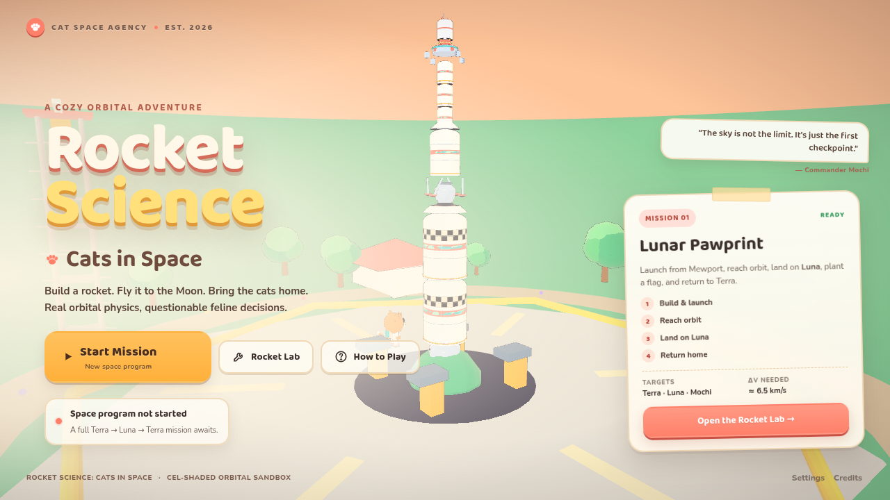

# Rocket Science: Cats in Space

A fully playable, cel-shaded orbital sandbox in the spirit of Kerbal Space Program — built with Three.js, TypeScript and Vite, crewed entirely by cats.

Build a rocket in the Rocket Lab, fly it to orbit around Terra, transfer to **Luna**, land, plant a flag, launch again, and bring the crew home. The same physics supports a second moon (**Mochi**) and two interplanetary destinations (**Rusty** and **Verdant**).

## Quick start

    npm install
    npm run dev

Open the local URL, click **Start Mission**, keep the default **Moon Cat Mk II**, and hit **Launch**.

The fastest way to see the full mission is to keep the Moon Cat preset, launch, then press **Full Mission (Auto)** in the Flight Computer. Auto-warp accelerates the transfer. The autopilot uses the same controls, thrust, fuel and patched-conic physics as manual flight.

### Controls

| Action | Key |
| --- | --- |
| Pitch / yaw | W A S D |
| Roll | Q E |
| Throttle up / down | Shift / Ctrl |
| Full / cut throttle | Z / X |
| Stage | Space |
| SAS / RCS | T / R |
| Landing gear / parachute | G / P |
| Map | M |
| Time warp | , / . |
| Pause | Esc |
| RCS translate | H/N, J/L, I/K |

SAS modes: stability, prograde, retrograde, radial in/out, normal +/-, target, surface up. Mouse drag orbits the camera; wheel zooms.

## Features

- **Rocket builder** — command pods, 3 tank sizes, 5 engines, decouplers, SAS, RCS, fins, landing legs, parachutes and solid boosters. Live Δv, TWR, mass, staging and cost readout with presets and undo.
- **Real flight physics** — Tsiolkovsky Δv, pressure-dependent thrust and Isp, fuel mass flow, atmospheric drag, 6-DOF attitude with reaction wheels, RCS, engine gimbal, parachutes, landing legs and terrain collisions.
- **Orbital mechanics** — two-body patched conics with recursive spheres of influence, rotating launch site, Keplerian rails time warp, Ap/Pe/period/inclination telemetry, trajectory map and maneuver planning.
- **Piloting** — navball with prograde/retrograde/radial/normal/target markers, SAS hold modes, RCS translation, throttle and staging.
- **Flight computer** — automatic ascent, circularization, trans-lunar injection, capture, powered descent, lunar ascent, return and re-entry. Full-mission autopilot.
- **Destinations** — Terra, Luna, Mochi, Rusty, Verdant and Sol. The Moon has a second inclined moon; Rusty has a thin atmosphere; Verdant is a gas giant. Mochi needs a manual plane change; the planets need manual interplanetary flight.
- **Cel-shaded art** — custom 3-band toon shader with warm rim light, inverted-hull contours, soft pastel palette, procedural cat astronaut, cat-eared capsule, procedural planets, terrain, trees, flowers, launch pad and gantry.
- **Audio, saves and settings** — synthesized engine rumble, UI chimes and ambient pads; localStorage design/progress/settings persistence; quality, volume, auto-warp and progress reset.
- **Missions** — *Lunar Pawprint*: launch, orbit, land on Luna, plant a flag, return to Terra. Progress is saved between sessions.

## Mission profile

The default Moon Cat Mk II is tuned around a KSP-scale Terra (600 km radius, μ = 3.5316×10¹² m³/s², 70 km atmosphere) and Luna (12,000 km orbit, μ = 6.5138×10¹⁰ m³/s²).

| Phase | Typical Δv |
| --- | --- |
| Liftoff → 80 km orbit | ≈ 3.4 km/s + gravity/drag losses |
| Trans-lunar injection | ≈ 0.85 km/s |
| Lunar capture + landing | ≈ 0.9 km/s |
| Lunar ascent + trans-Earth injection | ≈ 0.9 km/s |
| Earth return trim + re-entry | ≈ 0.1–0.3 km/s |

The verified default mission reaches orbit, lands on Luna at ~1.5 m/s, returns, and lands on Terra at ~9.3 m/s with fuel to spare. Run the physics test for the headless end-to-end assertion.

## Project layout

    src/game/       bodies, parts, rocket assembly, ship physics, autopilot, orbital math
    src/render/     toon shader, planet/atmosphere shaders, terrain, models, sky, effects
    src/ui/         navball, 2D flight map, audio, icons
    src/app.ts      application state machine, builder, HUD, missions, saves
    src/appExtras.ts  DOM/UI implementation for the screens
    tests/e2e.cjs   Playwright UI smoke test
    tools/          reference screenshots, visual snapshots, mission verification
    docs/           physics, art direction, references, screenshots

## Verification

    npm run test:physics   # headless full mission: launch → Luna → land → return → Terra
    npm run test:ui        # Playwright: menu, builder edit, launch, map, autopilot orbit

## Physics notes

The simulation uses SI units in double precision. The ship is a single rigid body with computed mass, centre of mass and inertia; fuel drain changes mass and inertia. Gravity is the dominant body's two-body field, with patched-conic SOI transitions. Atmosphere is exponential with a co-rotating relative wind. Landed vessels are pinned to body-fixed coordinates so the rotating planet does not slide underneath them. See [docs/PHYSICS.md](docs/PHYSICS.md).

## Art notes

Every mesh is generated in code. The visual language is intentionally soft and toy-like: 3-band toon lighting, pastel materials, chunky dark contours, rounded silhouettes, cat ears on the command pod and a chibi cat pilot. Reference boards and iteration notes are in [docs/ART_DIRECTION.md](docs/ART_DIRECTION.md) and [docs/REFERENCES.md](docs/REFERENCES.md). No external game art is bundled.

## Deployment

The app builds as static files. A GitHub Actions workflow deploys the dist folder to GitHub Pages.

    npm run build
    npm run preview

## License

MIT.
